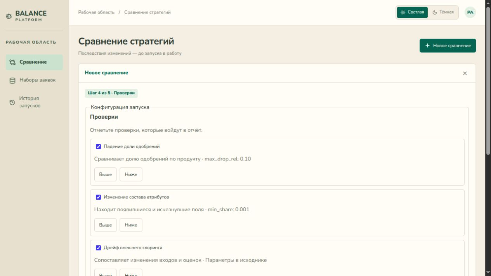
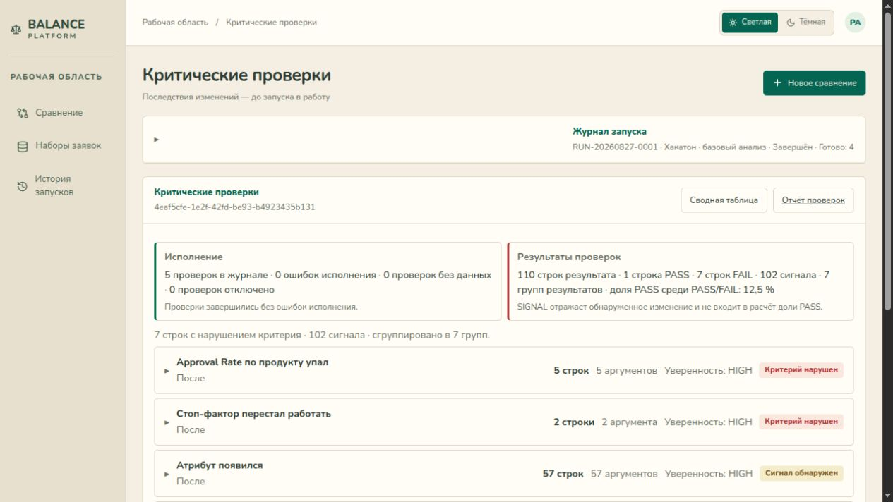
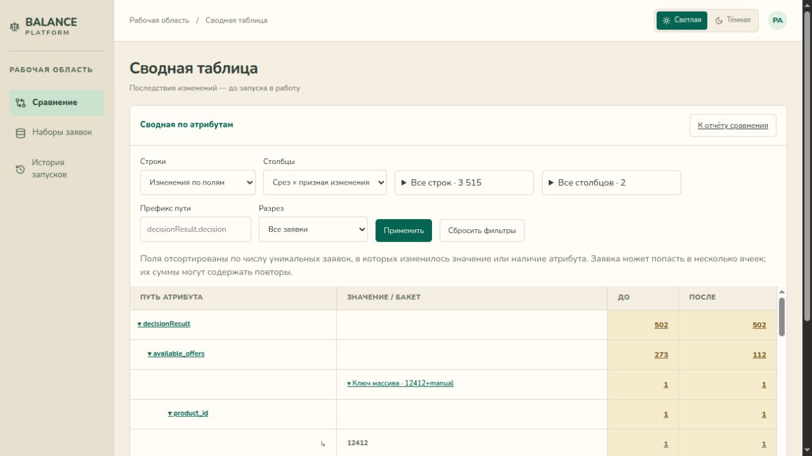
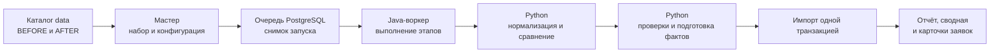

# BalancePlatform

[](pom.xml)
[](pom.xml)
[](python-src/)
[](docker-compose.yaml)
[](openapi.yaml)

**Команда** — _Узники террафирмы_.

**Задача** — «Система анализа изменений» системы принятия решений (СПР).

BalancePlatform сравнивает ответы старой и новой версий СПР по одним и тем же кредитным заявкам. Аналитик видит, по каким заявкам изменилось решение и какие поля отличаются между ответами.

## Содержание

- [Авторы](#авторы)
- [Возможности](#возможности)
- [Скриншоты интерфейса](#скриншоты-интерфейса)
  - [Настройка проверок](#настройка-проверок)
  - [Результаты проверок](#результаты-проверок)
  - [Сводная по атрибутам](#сводная-по-атрибутам)
- [Структура репозитория](#структура-репозитория)
- [Технологии](#технологии)
- [Данные](#данные)
- [Архитектура и подход](#архитектура-и-подход)
- [Эксперименты и результаты](#эксперименты-и-результаты)
- [Установка и запуск](#установка-и-запуск)
  - [Развёртывание через Docker Compose](#развёртывание-через-docker-compose)
  - [Локальный запуск](#локальный-запуск)
  - [Воспроизведение базового результата](#воспроизведение-базового-результата)
- [Документация](#документация)
- [API Reference](#api-reference)
- [Ограничения и дальнейшее развитие](#ограничения-и-дальнейшее-развитие)
- [Приложение](#приложение)
  - [Контракты расширения](#контракты-расширения)

## Авторы

- Сальцев Ярослав Алексеевич
- Лисов Алексей Олегович
- Кряжев Артем Денисовеч

## Возможности

- Выберите набор из `data` и посмотрите пример ответов BEFORE и AFTER.
- Задайте правила нормализации, подписи полей и интервалы значений. Для отдельных этапов можно выбрать установленный Python-скрипт или написать свой в редакторе при включённой песочнице.
- В отчёте откройте матрицу решений, отфильтруйте заявки и посмотрите значения изменившихся полей.
- В сводной выберите строки, столбцы и разрез, например по продукту. Нажмите на число в ячейке, чтобы открыть заявки и поля, которые в неё вошли.
- Запустите проверки по шаблонам или своим условиям и скачайте HTML-отчёт со ссылками на заявки.
- Сохраняйте настройки для следующих запусков. В журнале можно открыть код и параметры этапов и повторить завершённый запуск из снимка v2.

## Скриншоты интерфейса

### Настройка проверок



### Результаты проверок



### Сводная по атрибутам



## Структура репозитория

| Путь | Назначение |
| --- | --- |
| [src/main/java/com/kratti](src/main/java/com/kratti) | REST-контроллеры, фоновые задачи, сервисы и доступ к PostgreSQL |
| [src/main/resources/static](src/main/resources/static) | Браузерный интерфейс на HTML, CSS и JavaScript |
| [src/main/resources/db/migration](src/main/resources/db/migration) | Миграции схемы Flyway |
| [python-src](python-src) | Нормализация, сравнение, проверки и подготовка фактов |
| [src/test](src/test) | Тесты Java-приложения |
| [data](data) | Локальные пакеты датасетов. Git хранит только файл-заполнитель |
| [openapi.yaml](openapi.yaml) | Контракт HTTP API |
| [pom.xml](pom.xml) | Зависимости и сборка Maven |
| [Dockerfile](Dockerfile), [docker-compose.yaml](docker-compose.yaml), [.env.example](.env.example) | Образ приложения, локальное окружение и шаблон настроек |

## Технологии

| Слой | Технологии |
| --- | --- |
| Сервер | Java 21, Spring Boot 4.1.2, Spring MVC, Spring Security, Spring Data JPA, JDBC, Jackson, Lombok |
| Обработка | Python 3.10+ и стандартная библиотека, CSV и JSON Lines для обмена результатами |
| Хранение | PostgreSQL 17 в Compose, Flyway, пакетный импорт через PostgreSQL `COPY` |
| Интерфейс | HTML, CSS и JavaScript, сборка фронтенда не требуется |
| Инструменты | Maven, Docker Compose, OpenAPI, Bubblewrap и libseccomp для изоляции пользовательского Python на Linux |

Скоринг выполняет внешняя СПР. На вход BalancePlatform поступают её готовые JSON-ответы.

## Данные

Для ручных прогонов взяли пакет организаторов `RUN-20260827-0001`. В нём 2 002 заявки и 4 004 JSON-ответа. `BEFORE` соответствует срезу MASTER, `AFTER` — BETA.

Распакуйте каждый пакет в отдельную подпапку `data`. Структура пакета организаторов выглядит так.

```text
data/
└── RUN-20260827-0001/
    ├── manifest.json
    └── RESULTS/
        ├── BEFORE_MASTER/
        │   └── I32554355.json
        └── AFTER_BETA/
            └── I32554355.json
```

В манифесте укажите уникальный `run_id`, число заявок `applications` и относительные пути `srez.BEFORE.dir` и `srez.AFTER.dir`. Имя JSON-файла без расширения служит идентификатором заявки. Для каждой заявки нужен одноимённый файл в обоих срезах и итоговое решение `APPROVE` или `REJECT`. Каталоги и файлы должны находиться внутри пакета без символьных ссылок.

После добавления пакета перезапустите приложение и выберите набор по `run_id` в мастере **«Новое сравнение»**. Сервер использует этот `run_id`, чтобы при каждом старте присваивать набору тот же UUID.

## Архитектура и подход



1. **Постановка в очередь.** Сервер сохраняет параметры, конфигурацию и выбранные исходники. Браузер получает идентификатор запуска и опрашивает статус.
2. **Нормализация.** Вложенные JSON приводятся к атрибутам с путём, ключом массива и значением. Штатные правила исключают технические поля `appData.request_id` и `appData.createDateTime`. Массивы с бизнес-ключами сопоставляются по ключам, позиционные векторы — по индексу. При выбранном отдельном нормализаторе воркер проверяет его JSONL перед сравнением.
3. **Сравнение.** Штатная процедура сверяет пары по ID заявки и сопоставляет атрибуты двух сторон. Она различает добавление, исчезновение и изменение значений, отдельно фиксируя смену итогового решения. Результат передаётся в `applications.csv`, `comparison.csv`, `segments.csv` и `summary.json`.
4. **Проверки и факты.** Включённые проверки формируют `checks.json`. Отдельная подготовка фактов может ограничить состав сводной через `facts.csv`. Конфигурация задаёт порядок этих двух этапов.
5. **Публикация.** Импорт сверяет метаданные и сохраняет результаты в одной транзакции. Отчёт доступен после перехода в `COMPLETED`. Сводная считает уникальные заявки, а переход к детализации использует тот же состав фактов.
6. **Повтор.** Для завершённого запуска v2 можно повторно использовать сохранённый снимок. Воркер сверяет SHA-256 входа и штатного Python до обработки и перед публикацией.

## Эксперименты и результаты

| Что проверили | Сценарий | Результат |
| --- | --- | --- |
| Штатный расчёт и отчёт | Полный прогон MASTER → BETA | 2 002 заявки, **502** с отличиями (25,1%), **385** со сменой решения (19,2%) |
| Изменение одной заявки | В копии пакета поменяли решение AFTER заявки `I32554355` с `REJECT` на `APPROVE` | 2 002 заявки, **503** с отличиями, **386** со сменой решения |
| Фильтр по продукту | Продукт `12412`, поле итогового решения | 767 заявок без смены решения и 180 со сменой. Сверили оба числа с исходными JSON |
| Сводная только по отличиям | Подключили `prepare_changed_facts.py` | Общие счётчики сохранились. В детализации ячейки остались только изменившиеся атрибуты |
| Повторяемость | Повтор из снимка v2 после правки сохранённой конфигурации | Счётчики и отпечатки совпали. При изменении входных файлов повтор завершился с `INPUT_CHANGED` |

В одном ручном прогоне на Linux с Docker Compose и PostgreSQL 17 от отправки запроса до статуса завершения прошло **9,60 с**. Медиана четырёх HTTP-запросов полной сводной составила **1,94 с**, запрос с префиксом итогового решения — **18 мс**. Время рендера браузера и внешней сети в эти замеры не входило.

## Установка и запуск

### Развёртывание через Docker Compose

Требуются Docker Engine и Docker Compose v2. Из корня проекта:

```bash
cp .env.example .env
```

Задайте `POSTGRES_PASSWORD` в `.env` и распакуйте пакет в `data/<имя-пакета>/`. При необходимости укажите абсолютный путь к другому каталогу пакетов через `BALANCE_DATASETS_PATH`. Для автоматических проверок укажите путь к доверенному каталогу с `check_*.py` через `BALANCE_CHECKS_PATH`.

```bash
docker compose up --build -d
docker compose logs -f app
```

Откройте [http://localhost:8080](http://localhost:8080). Порт можно задать через `APP_PORT`. После добавления пакета в подключённый каталог выполните `docker compose restart app`. Для остановки используйте `docker compose down`. Данные PostgreSQL сохраняются в именованном томе.

### Локальный запуск

Требуются JDK 21, Maven, Python 3.10+ и PostgreSQL. Базу можно запустить отдельно через `docker compose up -d postgres`. Из корня репозитория укажите параметры своего подключения и запустите приложение:

```bash
export SPRING_DATASOURCE_URL=jdbc:postgresql://localhost:5432/balanceplatform
export SPRING_DATASOURCE_USERNAME=balanceplatform
export SPRING_DATASOURCE_PASSWORD='пароль базы данных'
mvn -Dmaven.test.skip=true spring-boot:run
```

### Воспроизведение базового результата

В браузере откройте **«Новое сравнение»**, выберите `RUN-20260827-0001` и запустите сравнение со штатной нормализацией и без пользовательских процедур. После завершения сверьте три счётчика с таблицей результатов. Затем откройте сводную, выберите префикс `decisionResult.decision` и разрез по продукту `12412`. Нажмите на число в ячейке, чтобы открыть заявки и значения полей.

Штатный расчёт также можно воспроизвести отдельно от сервера:

```bash
work_dir=$(mktemp -d)
python3 python-src/compare_dataset.py data/RUN-20260827-0001 "$work_dir/result"
cat "$work_dir/result/summary.json"
```

Для контрольного сценария сделайте копию пакета, задайте ей новый `run_id`, измените `decisionResult.decision` в AFTER-файле `I32554355.json` и выполните тот же расчёт в новом выходном каталоге.

Чтобы воспроизвести отчёт проверок без сервера, укажите каталог со скриптами из пакета организаторов. Используйте результат штатного расчёта из примера выше.

```bash
checks_dir='/абсолютный/путь/к/checks'
python3 python-src/run_check.py "$work_dir/result" --report "$checks_dir"/check_*.py
```

## Документация

- [OpenAPI](openapi.yaml) — параметры, схемы запросов и ответов, коды ошибок.
- [Docker Compose](docker-compose.yaml) и [шаблон окружения](.env.example) — переменные запуска и подключение каталогов.
- [Нормализатор](python-src/normalize_dataset.py), [сравнение](python-src/compare_dataset.py), [проверки](python-src/run_check.py), [подготовка фактов](python-src/prepare_changed_facts.py) — примеры контрактов этапов.

## API Reference

| Метод и маршрут | Назначение | Основные параметры |
| --- | --- | --- |
| `GET /api/datasets` | Каталог наборов | `page`, `size` |
| `GET /api/comparisons/workspace` | Получить cookie `BALANCE_WORKSPACE` | — |
| `GET /api/comparisons/datasets/{datasetId}/preview` | Предпросмотр пары ответов | `datasetId` — UUID набора |
| `POST /api/comparisons` | Поставить запуск в очередь, ответ `202` | `datasetId` обязателен. Можно передать `configurationId` или `draft` |
| `GET /api/comparisons/{id}` | Статус и журнал этапов | `id` — UUID запуска |
| `GET /api/comparisons/{id}/report` | Счётчики и матрица решений | `id` |
| `GET /api/comparisons/{id}/applications` | Список заявок | `page`, `size`, `hasDiff`, `decisionChanged`, `decisionBefore`, `decisionAfter` |
| `GET /api/comparisons/{id}/applications/{applicationId}` | Фактические отличия одной заявки | `applicationId` — имя файла без расширения |
| `GET /api/comparisons/{id}/pivot` | Сводная по уникальным заявкам | `rows`, `columns`, `prefix`, `segment`, `segmentValue` |
| `GET /api/comparisons/{id}/checks` | Результаты проверок | `id` |
| `GET /api/comparisons/{id}/checks.html` | HTML-отчёт проверок | `download=true` для скачивания |
| `POST /api/comparisons/{id}/replay` | Повтор завершённого запуска v2 | `id` |

Пример постановки задачи через HTTP. Возьмите UUID из поля `items[].id` ответа каталога. Для запросов к новому запуску используйте ту же cookie рабочей области.

```bash
base_url=http://localhost:8080
cookie_file=$(mktemp)
curl -fsS -c "$cookie_file" "$base_url/api/comparisons/workspace"
curl -fsS "$base_url/api/datasets"

dataset_id='<UUID набора из каталога>'
curl -fsS -i -b "$cookie_file" -H 'Content-Type: application/json' \
  -d "{\"datasetId\":\"$dataset_id\"}" "$base_url/api/comparisons"
```

Опросите URL из заголовка `Location` с той же cookie. После статуса `COMPLETED` откройте `/report` для этого запуска.

## Ограничения и дальнейшее развитие

- Сервер читает локальные пакеты при старте. В дальнейшем каталог можно обновлять без перезапуска и подключать внешние источники через `DatasetSourceProvider`.
- Рабочая область привязана к cookie браузера. Для командного использования нужны учётные записи и управление доступом.
- Воркер рассчитан на один экземпляр приложения. Замеры относятся к открытому пакету из 2 002 заявок. Для оценки пределов нужны прогоны на более крупных наборах и с несколькими одновременными заданиями.
- Отчёт фиксирует изменения полей и решений. Для установления причин нужны трассы исполнения внешней СПР.
- Код из редактора требует Linux с Bubblewrap и libseccomp и включённой настройкой `BALANCE_PYTHON_SANDBOX_ENABLED=true`. Стандартный Compose рассчитан на штатный и доверенный серверный Python. Отпечаток повтора охватывает входные файлы и штатный код. Версии интерпретатора и внешние зависимости требуют отдельного контроля.

## Приложение

### Контракты расширения

| Этап | Вход | Выход |
| --- | --- | --- |
| Отдельная нормализация | Каталог пакета и путь нового файла | `normalized.jsonl` со строками `appId`, `source`, `path`, `arrayKey`, `value`. Группы упорядочены по `appId` |
| Сравнение | Каталог пакета и путь нового каталога результата. Если задано, проверенный JSONL в `BALANCE_NORMALIZED_PATH` | Файлы сравнения и итоговые счётчики |
| Проверки | Витрина сравнения и выбранные условия | `checks.json`. В доле `PASS` учитываются только строки `PASS` и `FAIL` |
| Подготовка фактов | Каталог результата сравнения и путь нового файла | CSV с заголовком `APP_ID;PATH;ARRAY_KEY;SOURCE`. Каждая строка включает существующий срез атрибута в сводную |

В редакторе можно открыть исходник штатного сравнения, нормализатора или примера подготовки фактов. При локальном запуске `BALANCE_PROCEDURES_PATH` заменяет этот каталог доверенными файлами оператора. Скрипты получают параметры в `BALANCE_RUN_PARAMETERS` с объектами `procedure` и `checks`.

Старый поток исполнения пороговых стратегий доступен по `/api/legacy/datasets`, `/api/legacy/comparisons` и `/api/strategy-versions`. Его запуски хранятся отдельно от сравнений готовых ответов.
